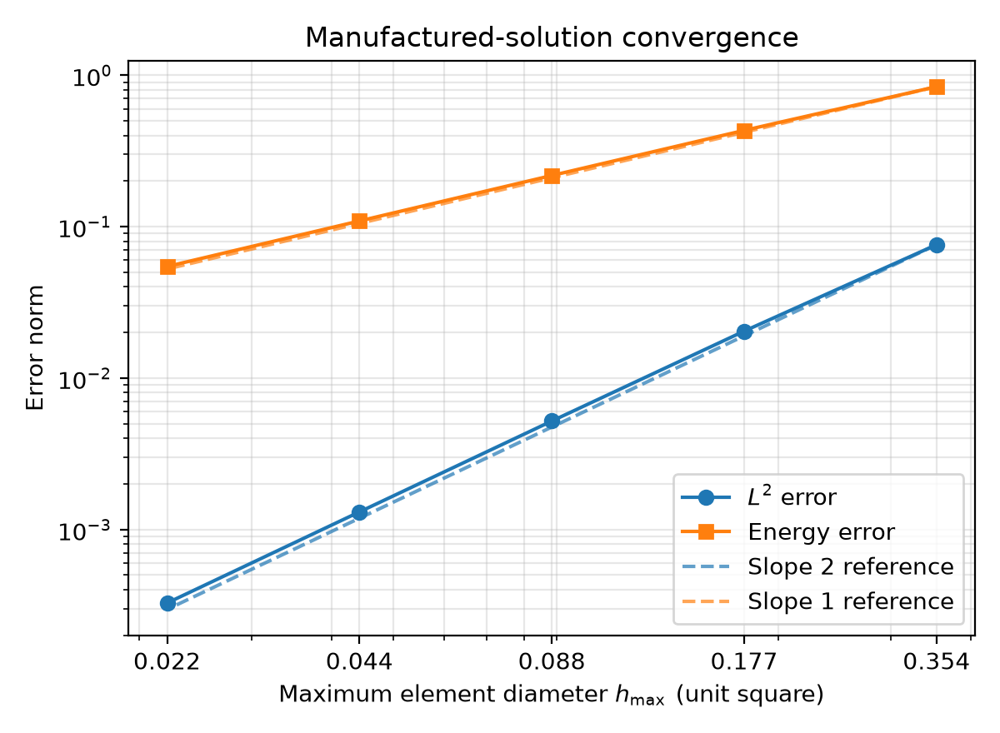
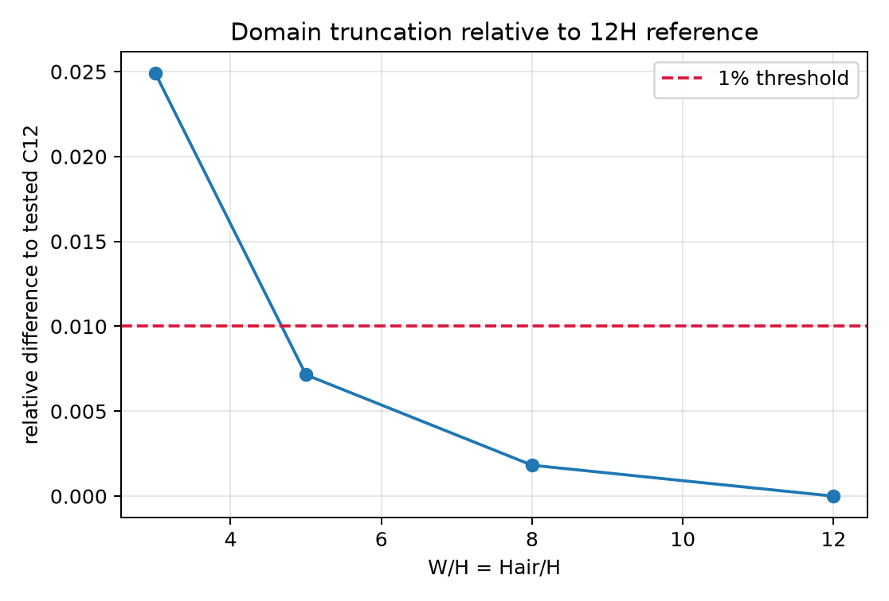
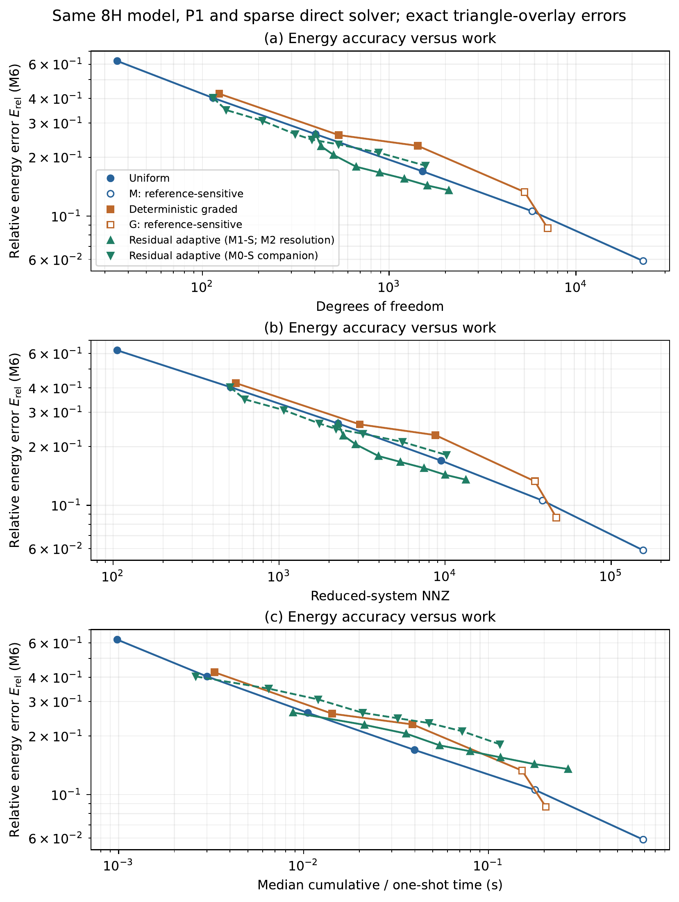

# Shuoran Fu — Project Contributions

**MTH321 Project 2 · Group C**  
Student ID: **2362626** · GitHub: [@Shuoran0420](https://github.com/Shuoran0420)

I worked on developing and organising the Python FEM implementation and numerical studies. I also wrote the first drafts of both the report and the presentation, designed their overall structure, and subsequently revised the report's technical sections. This folder connects those responsibilities to the code, saved results and repository history.

## Work and evidence

| My work | What to inspect |
|---|---|
| FEM implementation: geometry, boundary conditions, sparse assembly and electrostatic solution | [Geometry](../../code/geometry.py), [solver](../../code/fem_solver.py), [capacitance extraction](../../code/capacitance.py) |
| Numerical experiments: verification, domain size, uniform refinement and adaptive refinement | [Detailed contribution map](contribution_map.md), with functions, tests and result files |
| Numerical issue checking: cross-mesh energy integration and refinement comparisons | [Triangle-overlay calculation](../../code/overlay_energy.py), [adaptive tests](../../code/tests/test_residual_adaptive.py), [adaptive section](../../report/sections/residual_adaptive.tex) |
| Report first draft, overall structure and subsequent technical writing/revision: model, method, verification, experiments and conclusions | [Report source](../../report/main.tex) and [adaptive section source](../../report/sections/residual_adaptive.tex) |
| Presentation first draft: slide structure, initial slide content and selection of supporting figures | [Editable Beamer presentation](../../presentation/main.tex) |
| Project organisation and reproducibility | [Unified entry point](../../code/run_all.py), [reproduction workflow](../../code/reproduction.py), [verification records below](#verification-records) |

The map gives more detail than commit counts: it identifies the relevant implementation and the evidence used to check it.

## Archived report and presentation drafts

I wrote the first drafts of the report and presentation. The available versions have been copied into this folder so that later team revisions to the working files do not replace this record:

- [Report draft snapshot — 35 pages](drafts/Report_Draft_Shuoran_Fu.pdf).
- [Presentation draft snapshot — 13 slides](drafts/Presentation_Draft_Shuoran_Fu.pdf).

These are the available handoff versions archived on 2 November 2026, not a reconstruction of the earliest historical drafts. [Archive details and file hashes](drafts/README.md).

## Selected results

These are copies of existing project figures. Their source paths, data and SHA-256 hashes are recorded in [figure_provenance.csv](figure_provenance.csv).

### 1. Manufactured-solution verification



The fitted orders are approximately 2 in the L2 norm and 1 in the energy norm. This checks the implementation against a known solution before interpreting the microstrip calculation. See the [fit table](../../report/tables/mms_fit_summary.csv) and [verification code](../../code/verification.py).

### 2. Computational-domain comparison



The tested 8H production domain differs from the tested 12H domain by about 0.182%. The near-field mesh was controlled in this study. This supports a practical domain choice; it is not a rigorous truncation-error bound for the final M7 solution. See [the domain log](../../logs/gate_C_domain.txt).

### 3. Uniform, graded and residual-adaptive comparison



[Open the original vector PDF](figures/adaptive_work_precision.pdf).

At relative energy error 0.30, the saved log-log interpolation gives about 224 adaptive DOFs, compared with 273 uniform and 349 graded DOFs. These are interpolated costs, not three computed meshes with exactly those DOFs. The target uses the M0-S companion path. Adaptive refinement required about 18% fewer DOFs than uniform refinement, but about 1.83 times its cumulative time in the original experiment. The time comparison charges adaptive refinement for the preceding solve–estimate–refine cycles; it does not isolate linear-solver speed. Ideal N^(-1/2) adaptive efficiency was not demonstrated.

The [target table](../../results/adaptive_extension/adaptive_matched_targets.csv) and [analysis code](../../code/adaptive_analysis.py) contain the values and their reference-sensitivity checks. Historical graded centroid-based error estimates are not used as the final quantitative evidence; this comparison uses triangle-overlay integration.

## Verification records

| Evidence | Date and scope | Result |
|---|---|---|
| [pytest.txt](logs/pytest.txt) | 2 November 2026; original `code/tests` on the recorded repository snapshot | 58 passed in 21.75 s |
| [quick_summary.txt](logs/quick_summary.txt) | 2 November 2026; `python3 code/run_all.py --quick` | PASS; approximately 7.95 s |
| [environment.json](logs/environment.json) | Environment used for the November checks | Python and package versions |
| [Existing full-run summary](../../reproduction/minimal_20261028_152722/reproduction_summary.json) | 28 October 2026; historical integrated numerical reproduction | 208 comparisons passed; 185.75 s |

The November logs were captured during a coding-agent-assisted repository review. They are execution evidence for this snapshot, not a claim that I ran them without assistance. The full numerical run listed above is a separately dated existing record; quick mode does not repeat it. [Log details and commands](logs/README.md).

Run the following from the **repository root**, after installing the project's dependencies:

```bash
python3 -m zipfile -e data/processed/final_engineering_mesh.npz.zip data/processed
pytest -q code/tests
python3 code/run_all.py --quick
```

Quick mode checks saved data and rebuilds supported figures in a separate output directory. For numerical reproduction from solves, use `python3 code/run_all.py --full`; consult the [root README](../../README.md) for resource requirements. Neither command needs this contribution folder to run.

## Repository history and attribution

- [2b9dfed](https://github.com/Shuoran0420/MTH321_Project2/commit/2b9dfed0db366ce5117936fa04dd0a81fa10c9b3): my account uploaded the core solver, numerical study scripts and tests.
- [b5eee20](https://github.com/Shuoran0420/MTH321_Project2/commit/b5eee20c50f78abfc16908ccc8efb6fc0aa0d34b): my account uploaded report sources, tables and figures.
- [Verified commit metadata](commit_evidence.json) records those file lists and upload dates.

These commits document staged uploads rather than the complete development process. The responsibilities above follow my supplied contribution statement; uploading a team file does not by itself establish sole authorship. AI tools assisted with coding, debugging and writing. My work included reviewing their output against the mathematical model and numerical evidence. The separate `code_hardened` work is outside this personal contribution folder.
